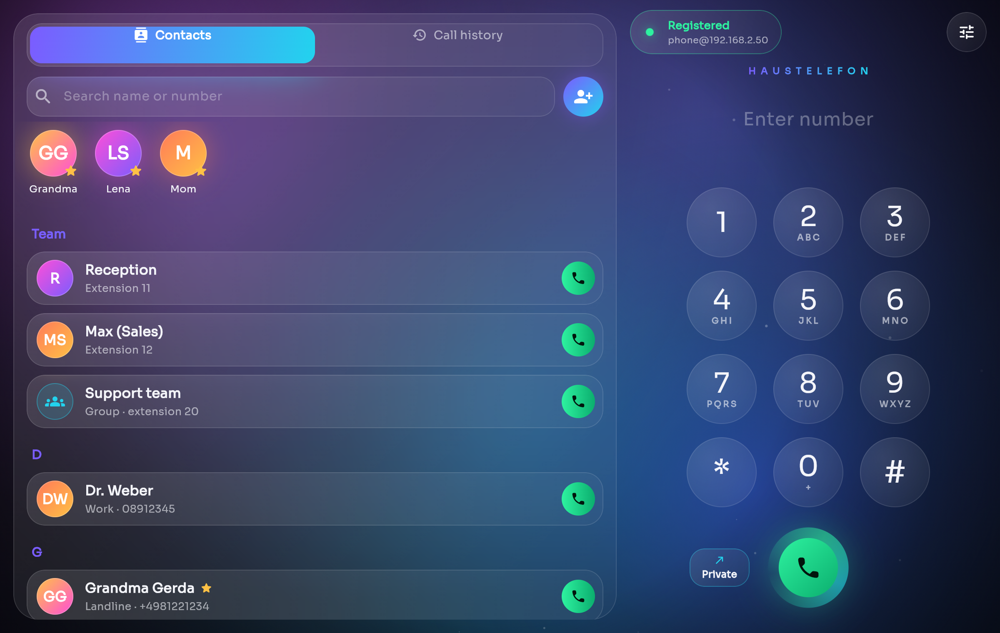
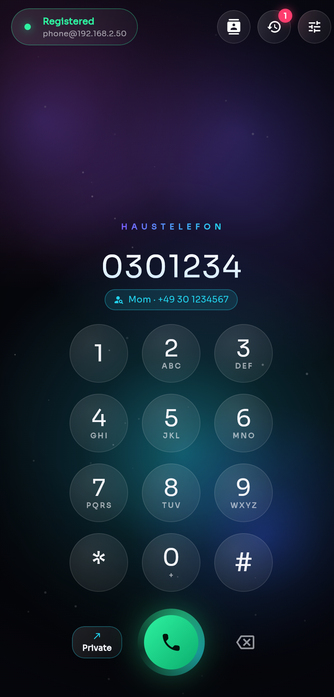
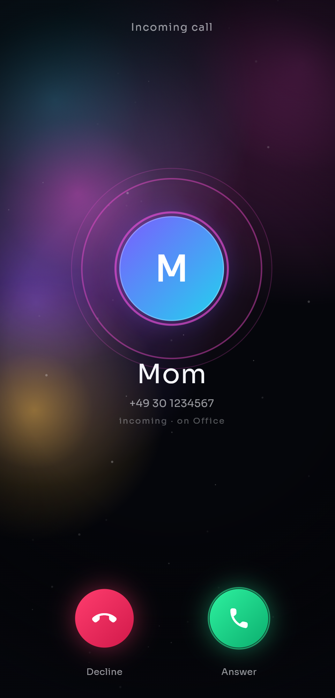
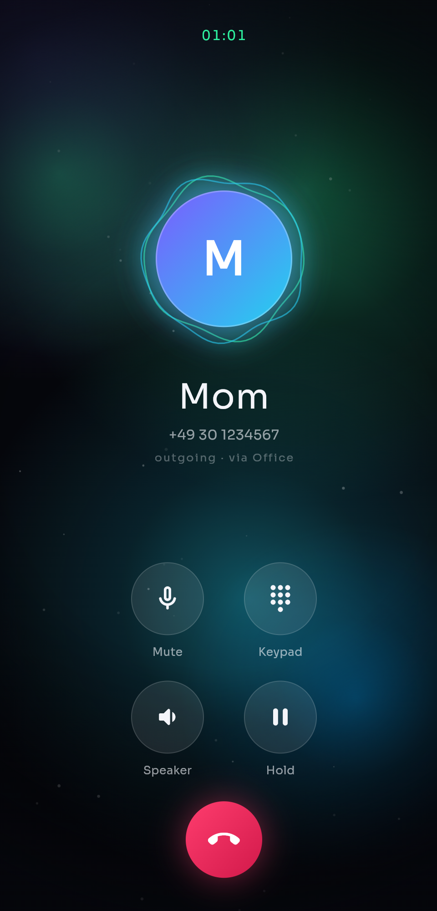

<div align="center">

# Haustelefon

**Self-hosted softphone & phone system for home and small office.**
Flutter app for Android, iOS, Windows and Linux + an Asterisk server generated from one YAML file.

[Deutsch](README.de.md) · [Architecture](docs/ARCHITECTURE.md) · [Changelog](CHANGELOG.md)

</div>

<p align="center">
  
</p>
<p align="center">
  
  
  
  
</p>

---

Turn the phone numbers of your internet router (built for the Telekom
**Speedport**, but the idea works with any router that registers IP phones) into
a small phone system: every family member or employee gets an app on their
phone or PC, an internal extension, and the right calls ring on the right devices.

## Features

- **Multiple phone numbers** – each number rings the devices/groups you choose;
  pick the outgoing number per call (with a default per device).
- **Internal extensions & ring groups** – `10`, `11`, `20` … call each other for free.
- **One config file** – `haustelefon.yaml` → complete Asterisk configuration,
  validated with readable error messages.
- **Setup codes** – the server prints one code per device; paste it into the app, done.
- **App** – animated dialer, in-call screen with live voice levels, call history,
  contacts & favourites, team directory, German & English UI.
- **Android** – stays reachable in the background, incoming-call notifications.
- **Windows** – runs in the notification area (stays reachable when the window
  is closed), optional start with Windows, keyboard control, audio device
  selection, microphone test, ringtones, taskbar flashing, one-click installer.
- **Linux** – the same desktop app (GTK): icon in the panel, start on login,
  ringtone via PipeWire/PulseAudio, `.deb` package.

## How it works

```
 Phones & PCs (Haustelefon app, WebRTC)
        │  SIP over WebSocket + encrypted audio (LAN or VPN)
        ▼
 Haustelefon server (Asterisk in Docker, e.g. Raspberry Pi)
        │  one SIP registration per phone number, plain RTP
        ▼
 Router with phone system (Speedport, …) ──▶ landline / internet telephony
```

**Why a server?** Like every WebRTC client, the app always sends encrypted audio
(DTLS-SRTP). Router phone systems only speak unencrypted RTP. Asterisk bridges
both worlds and adds what the router cannot do: extensions, groups and number
routing per device.

## Quick start

### 1. Router: one IP phone per number

Speedport: *Telefonie → Telefoniegeräte → IP-Telefon anlegen*. Create **one IP
phone per phone number**: incoming number = only that number, outgoing number =
the same number. Note *Nutzerkennung* (user ID), *Authentifizierungsname* and
password of each.

### 2. Server (Raspberry Pi or any Linux with Docker)

```bash
git clone https://github.com/<you>/haustelefon.git
cd haustelefon/server
cp haustelefon.example.yaml haustelefon.yaml
nano haustelefon.yaml        # numbers, router credentials, devices, groups
./setup.sh                   # installs Docker if missing, generates, starts Asterisk
./setup.sh codes             # setup code for every device
./setup.sh status            # registrations & connected devices
```

A minimal `haustelefon.yaml`:

```yaml
system:
  mode: home                  # home: lines without "ring" ring every device
  speedport_ip: 192.168.2.1
  server_host: 192.168.2.50   # address of this server as seen by the apps
lines:
  - id: private
    label: Private
    number: "+49 30 1111111"
    speedport: { user: "**71", auth: "nutzer-1@speedport.ip", password: "…" }
devices:
  - { id: phone, name: Phone, extension: 10 }
  - { id: pc,    name: PC,    extension: 11 }
```

See [`server/haustelefon.example.yaml`](server/haustelefon.example.yaml) for
every option (office mode, groups, allowed lines per device).

### 3. App

Install the app, choose **Paste setup code** in the setup wizard and paste the
device's code. To reach the server from outside your home, use a VPN
(e.g. WireGuard) – no ports need to be opened to the internet.

**Ready-made downloads** are on the [Releases](../../releases) page:

| Download | Install |
|---|---|
| `Haustelefon-<version>-android.apk` | Open on the phone, allow "install unknown apps" |
| `Haustelefon-<version>-windows-x64.zip` | Unzip, double-click `Install.cmd` – no admin rights needed |
| `Haustelefon-<version>-linux-amd64.deb` | Double-click or `sudo apt install ./Haustelefon-*.deb` (Ubuntu 22.04+, Debian 12+, Linux Mint 21+) |
| `Haustelefon-<version>-server.zip` | Unzip on the Raspberry Pi / server, continue with step 2 (`cd haustelefon-server`) |

**Building it yourself:**

| Platform | Build | Notes |
|---|---|---|
| Android | `flutter build apk --release` | Background service keeps the app reachable |
| Windows | double-click `Haustelefon-installieren.bat` | Builds, installs, creates shortcuts; no Developer Mode needed |
| Linux | `sudo apt install clang cmake ninja-build pkg-config libgtk-3-dev libsecret-1-dev libjsoncpp-dev libpulse-dev`, then `flutter build linux --release` | Bundle in `build/linux/x64/release/bundle`; panel icon needs `libayatana-appindicator3-1` at runtime |
| iOS | `flutter build ios` on a Mac | Reachable while open (see limitations) |

The Linux `.deb` is built by GitHub Actions: publishing a release runs
`.github/workflows/release.yml`, which attaches the package to the release.

Android release signing: put `storeFile`, `storePassword`, `keyAlias` and
`keyPassword` into `android/key.properties` (git-ignored). Without it, the
release build is signed with the debug key.

## Limitations

- **SMS** over landline numbers is not possible: Telekom and Vodafone shut down
  landline SMS in March 2023.
- **Linux panel icon**: needs libayatana-appindicator3; on GNOME (Fedora,
  Debian) additionally the *AppIndicator* extension. Without it, closing the
  window quits the app – starting it again always brings back the running window.
- **iOS background**: iOS closes network connections of background apps. Ringing
  while the app is closed would need PushKit/CallKit plus a push service.
- Tested with the Telekom Speedport Smart 4. Other routers with a built-in SIP
  registrar should work the same way but are untested – reports welcome.

## Troubleshooting

| Symptom | Fix |
|---|---|
| Red “No answer from …” | VPN off, wrong `server_host`, or port 8088/TCP blocked |
| “Username or password rejected” | Re-paste the setup code; check `./setup.sh codes` |
| Call connects but no audio | UDP 10000–10200 to the server blocked (firewall/VPN `AllowedIPs`) |
| Line shows `Rejected` in `./setup.sh status` | Router credentials wrong; some Speedports want the auth name without `@speedport.ip` |
| Linux: no icon in the panel | `sudo apt install libayatana-appindicator3-1`; on GNOME also enable the *AppIndicator* extension |
| Live Asterisk log | `docker exec -it haustelefon-asterisk asterisk -rvvv` |

## Development

```bash
flutter pub get && flutter analyze && flutter test       # app
cd server && python -m unittest discover -s generator   # generator
bash server/tests/validate_asterisk.sh                   # boots Asterisk (Docker)
```

Project layout and design decisions: [docs/ARCHITECTURE.md](docs/ARCHITECTURE.md).
Contributions welcome – see [CONTRIBUTING.md](CONTRIBUTING.md).

## License

[MIT](LICENSE). Asterisk runs as a separate container under its own GPL licence.
